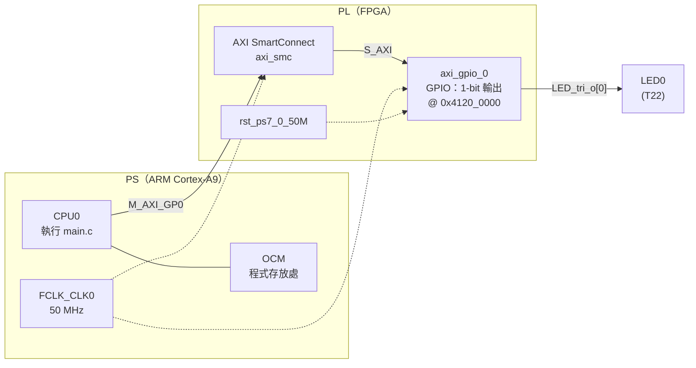
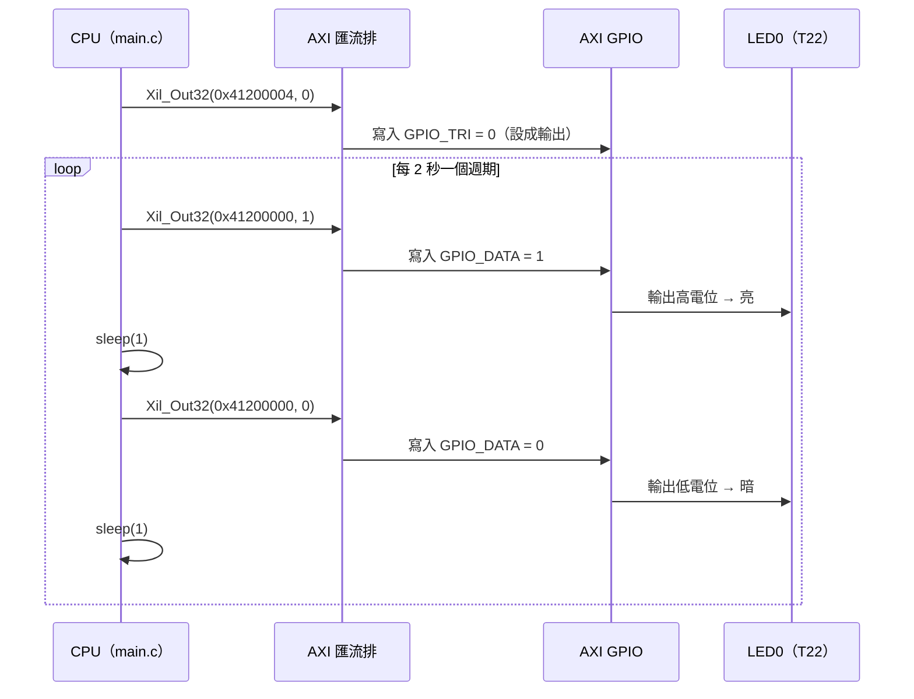

# HW2 作業 1：LED 閃爍（Zynq-7020 / EGO-XZ7）

> **功能**：讓板上 LED0 **亮 1 秒、暗 1 秒**，不斷重複。
> 由 ARM CPU 執行 C 程式，透過 AXI 匯流排寫入 PL 端 AXI GPIO 的暫存器來控制 LED。

| 項目 | 內容 |
|---|---|
| 開發板 | EGO-XZ7 |
| 晶片 | Xilinx Zynq-7000 **XC7Z020-CLG484-1** |
| 工具 | Vivado 2026.1、Vitis Unified IDE 2026.1 |
| 處理器 | ARM Cortex-A9（`ps7_cortexa9_0`），standalone（bare-metal） |
| 程式執行位置 | 晶片內部記憶體 OCM（`ps7_ram_0`） |

---

## 目錄

1. [作業目標](#1-作業目標)
2. [系統架構](#2-系統架構)
3. [硬體設計（Vivado）](#3-硬體設計vivado)
4. [軟體設計（Vitis）](#4-軟體設計vitis)
5. [建置與執行步驟](#5-建置與執行步驟)
6. [實驗結果](#6-實驗結果)
7. [觀察與討論](#7-觀察與討論)
8. [遇到的問題與解決方法](#8-遇到的問題與解決方法)
9. [檔案說明](#9-檔案說明)
10. [參考資料](#10-參考資料)

---

## 1. 作業目標

- [x] 在 Vivado 建立 Zynq PS + AXI GPIO 的硬體平台
- [x] 用 XDC 把 GPIO 輸出接到板上的 LED0（T22）
- [x] 在 Vitis 撰寫 C 程式，讓 LED0 **亮 1 秒、暗 1 秒**
- [x] 透過 JTAG 燒錄 bitstream 並執行程式

**重點觀念**：**記憶體對映 I/O（Memory-Mapped I/O）**。在 CPU 眼中，AXI GPIO 只是一段記憶體位址（`0x4120_0000`）；CPU 對這個位址寫入 1，LED 就會亮，寫入 0 就會暗。

---

## 2. 系統架構

### 2.1 方塊圖



### 2.2 一次寫入的過程



---

## 3. 硬體設計（Vivado）

### 3.1 Block Design


| 元件 | 設定 |
|---|---|
| **ZYNQ7 Processing System** | M_AXI_GP0 開啟；FCLK_CLK0 = 50 MHz；EMIO GPIO **不開** |
| **AXI GPIO**（`axi_gpio_0`） | GPIO：**All Outputs**，寬度 **1**；不開雙通道、不開中斷 |
| AXI SmartConnect（`axi_smc`） | Connection Automation 自動加入 |
| Processor System Reset（`rst_ps7_0_50M`） | Connection Automation 自動加入 |
| 外接腳位 | GPIO → 改名為 `LED`（Wrapper 中為 `LED_tri_o`） |

**建立步驟：**

1. 新專案，Part 選 **`xc7z020clg484-1`**（EGO-XZ7 沒有 board file，所以不選 Board）
2. Create Block Design → 加入 **ZYNQ7 Processing System**
3. Run Block Automation（**不套用** Board Preset）→ 產生 DDR、FIXED_IO
4. 雙擊 Zynq：
   - PS-PL Configuration → 開啟 **M AXI GP0**
   - Clock Configuration → **FCLK_CLK0 = 50 MHz**
   - MIO Configuration → **EMIO GPIO 不勾**
5. 加入 **AXI GPIO** → All Outputs、GPIO Width = 1
6. Run Connection Automation（GPIO、S_AXI 都勾）→ 自動加入 SmartConnect 與 Reset
7. 外接腳位改名為 **`LED`**
8. Validate Design（F6）→ Validation successful
9. Create HDL Wrapper（Let Vivado manage）

### 3.2 為什麼用 AXI GPIO，而不是 PS 的 GPIO

| 方式 | 位置 | 接到哪裡 | 本作業 |
|---|---|---|---|
| GPIO MIO | PS 內建 | PS 專用 MIO 腳位 | ❌ |
| EMIO GPIO | PS 內建 | 經過 PL 接到 FPGA 腳位 | ❌ |
| **AXI GPIO** | **PL 的 IP** | **FPGA 腳位** | ✅ |

EGO-XZ7 的 LED0 接在 **PL 腳位 T22**，因此在 PL 加一個 AXI GPIO，由 CPU 透過 AXI 匯流排控制。


### 3.3 Address Map


| Slave | Base Address | Range |
|---|---|---|
| `axi_gpio_0/S_AXI` | **`0x4120_0000`** | 64K |

| 偏移 | 暫存器 | 用途 | 本作業的寫入值 |
|---|---|---|---|
| `0x000` | **GPIO_DATA** | 輸出資料，bit0 → LED0 | `1` = 亮、`0` = 暗 |
| `0x004` | **GPIO_TRI** | 方向，0 = 輸出、1 = 輸入 | `0` |

（暫存器定義：PG144《AXI GPIO Product Guide》）

### 3.4 腳位限制（[`vivado/pin.xdc`](vivado/pin.xdc)）

```tcl
set_property PACKAGE_PIN T22 [get_ports {LED_tri_o[0]}]
set_property IOSTANDARD LVCMOS33 [get_ports {LED_tri_o[0]}]
```

| 頂層腳位 | 晶片腳 | 板上元件 | 方向 | I/O 標準 |
|---|---|---|---|---|
| `LED_tri_o[0]` | **T22** | LED0 | 輸出 | LVCMOS33（3.3V） |

- 腳位依據：EGO-XZ7 硬體手冊表 15
- **RTL 與 XDC 的分工**：RTL（Block Design 自動產生的 `design_1_wrapper.v`）只宣告「有一個輸出叫 `LED_tri_o`」；XDC 負責把它綁到實體的 T22 腳，並指定電壓標準


### 3.5 實作結果


- Synthesis、Implementation、Bitstream 全部完成
- WNS、WHS 皆為正值（時序符合要求）
- Export Hardware → **Include bitstream** → `design_1_wrapper.xsa`

---

## 4. 軟體設計（Vitis）

程式碼：[`vitis/main_led.c`](vitis/main_led.c)

```c
#include "xil_io.h"
#include "sleep.h"

#define LED_BASE  0x41200000U   /* axi_gpio_0 基底位址（Address Editor） */
#define GPIO_DATA 0x0U          /* 資料暫存器：1 = 亮 */
#define GPIO_TRI  0x4U          /* 方向暫存器：0 = 輸出 */

int main(void)
{
    Xil_Out32(LED_BASE + GPIO_TRI, 0x0);      /* 設成輸出 */

    while (1) {
        Xil_Out32(LED_BASE + GPIO_DATA, 0x1); /* LED0 亮 */
        sleep(1);
        Xil_Out32(LED_BASE + GPIO_DATA, 0x0); /* LED0 暗 */
        sleep(1);
    }
    return 0;
}
```

| 函式 | 來源 | 作用 |
|---|---|---|
| `Xil_Out32(addr, val)` | BSP `xil_io.h` | 對位址 `addr` 寫入 32-bit 值，本質是 `*(volatile u32 *)addr = val` |
| `sleep(1)` | BSP `sleep.h` | 用 Cortex-A9 的 Global Timer 計時 1 秒 |

**說明：**

- 本作業**不使用** `XGpio` 驅動程式，直接讀寫暫存器，更能看出「寫位址 = 控制硬體」的原理
- 程式放在 **OCM**（`lscript.ld` 的區段改成 `ps7_ram_0`）。因為 EGO-XZ7 沒有 board preset，DDR 參數不一定正確；OCM 不需要額外設定，比較可靠
- Application 使用 **`empty_application`** 範本。`hello_world` 範本需要 UART，而本設計沒有開 UART

---

## 5. 建置與執行步驟

### 5.1 Vivado

1. 依照 [3.1](#31-block-design) 建立 Block Design
2. 加入 [`vivado/pin.xdc`](vivado/pin.xdc)
3. Generate Bitstream
4. File → Export → Export Hardware → **Include bitstream** → `design_1_wrapper.xsa`

### 5.2 Vitis（腳本自動建立）

中文版 Windows 直接操作 Vitis 會遇到編碼錯誤（見[第 8 節](#8-遇到的問題與解決方法)），所以改用 Vitis 的 Python API 搭配批次檔建立專案：

1. 把 `vitis/` 裡的三個檔案和 `design_1_wrapper.xsa` 放在同一個資料夾
2. 按兩下 [`run_led.bat`](vitis/run_led.bat)，它會：
   - 設定 UTF-8 環境（`chcp 65001`、`PYTHONUTF8=1`）
   - 在 `C:\vitis_led\ws` 建立 Platform（`led_platform`）和 Application（`led_blink`）
   - 把 [`main_led.c`](vitis/main_led.c) 複製成 `main.c`
   - 把 `lscript.ld` 改成 `ps7_ram_0`
   - 編譯出 `led_blink.elf`，接著打開 Vitis
3. 在 Vitis 左下 **FLOW → Component** 選 `led_blink` → **Run**


按下 Run 後，Vitis 會依序執行：連上 JTAG → `ps7_init` 初始化 PS → **燒錄 bitstream 到 PL** → 載入 `led_blink.elf` 到 OCM → 從 `main()` 開始執行。

### 5.3 板子設定（EGO-XZ7）

| 項目 | 設定 |
|---|---|
| SW8 第 1 位 | **0**（Cascaded JTAG） |
| SW8 第 4:2 位 | **000**（JTAG 開機模式） |
| SW8 第 5 位 | 0（使用 PLL） |
| 電源 | 12V 接 J9，S1 開啟（D17 亮） |
| JTAG | Micro USB 接 J1 |

修改 SW8 後要**斷電再上電**，開機模式才會生效。

---

## 6. 實驗結果


https://github.com/user-attachments/assets/99b72375-1bc9-4f8a-bc9c-ea037713176f


| 測試項目 | 預期 | 結果 |
|---|---|---|
| LED0 狀態 | 亮 1 秒、暗 1 秒，持續重複 | ✅ 符合 |
| 只在 Vivado 燒 bitstream，不執行程式 | LED0 不會閃（CPU 沒有寫入 GPIO） | ✅ 符合 |

---

## 7. 觀察與討論

### 7.1 軟體計時 vs. 硬體計時

同樣是「一秒閃一次」，也可以完全不用 CPU，只用 Verilog 計數器實作：

```verilog
module led_blink (input wire clk, output reg led);   // clk = 100 MHz (Y9)
    reg [26:0] cnt = 0;
    always @(posedge clk)
        if (cnt == 27'd99_999_999) begin cnt <= 0; led <= ~led; end
        else cnt <= cnt + 1;
endmodule
```

| | 本作業（SoC：CPU + AXI GPIO） | 純 RTL |
|---|---|---|
| 計時方式 | C 程式 `sleep(1)` | 硬體計數器數 1 億個 clock |
| 修改閃爍速度 | 改 C 程式，重新編譯即可 | 改 Verilog，重跑合成、實作、bitstream |
| 需要的工具 | Vivado + Vitis | 只要 Vivado |
| 學到的觀念 | 記憶體對映 I/O、AXI 匯流排、BSP | 時序邏輯、計數器 |

SoC 的做法把「功能」交給軟體、「介面」交給硬體，修改彈性較高，也是作業 2 中斷實驗的基礎。

### 7.2 為什麼只燒 bitstream 時 LED 不會閃

bitstream 只把 AXI GPIO 電路放進 PL，但 GPIO_DATA 的初始值是 0，要等 CPU 執行程式寫入 1，LED 才會亮。這證明 LED 是由**軟體**透過暫存器控制的。

---

## 8. 遇到的問題與解決方法

| 問題 | 原因 | 解決方法 |
|---|---|---|
| Vivado 2026.1 出現 no licensed parts | 2026.1 需要免費的 BASIC tier 授權 | 到 AMD 授權網站申請 BASIC 授權 |
| 找不到 EGO-XZ7 的 Board 檔 | 廠商沒有提供 board file | 改用 Part `xc7z020clg484-1`，腳位自己寫 XDC |
| Wrapper 出現 `LED_tri_io` | 誤開 EMIO GPIO，或 AXI GPIO 沒選 All Outputs | 關閉 EMIO，AXI GPIO 選 All Outputs |
| `[BD 41-758]` s_axi_aclk 沒接 | Connection Automation 沒跑完整 | 重跑 Connection Automation，確認 FCLK_CLK0 有接 |
| `[Common 17-1257] Failed to create directory 'C'` | 舊的失敗訊息殘留 | 確認 Design Runs 全部 Complete 後清除訊息 |
| Vitis 選單沒有 Platform / Application | 中文版 Windows 編碼為 Big5，Vitis 後端出現 `'utf-8' codec can't decode byte 0xa8` | `chcp 65001`、`PYTHONUTF8=1`，改用 Python API 建立專案 |
| `hello_world requires at least one serial hardware instance` | 設計中沒有開 UART | 改用 `empty_application` 範本 |
| `Vitis IDE cannot recognize the workspace version` | 資料夾裡有失敗時殘留的 `_ide` | 改用全新的子資料夾 `ws` 當 workspace |
| `Could not find ARM device on the board` | SW8 為出廠設定（分離 JTAG + SD 卡開機） | SW8 第 1～5 位撥到 0，斷電再上電 |

---

## 9. 檔案說明

```
.
├── README.md              本說明文件
├── vivado/
│   └── pin.xdc            腳位限制（LED0 → T22）
├── vitis/
│   ├── main_led.c         C 程式：LED0 亮 1 秒、暗 1 秒
│   ├── make_led.py        Vitis Python API 腳本：建立 Platform、App 並編譯
│   └── run_led.bat        一鍵執行：設定 UTF-8、執行腳本、開啟 Vitis
└── images/                報告截圖
```

---

## 10. 參考資料

- AMD/Xilinx, *Zynq-7000 SoC Technical Reference Manual* (**UG585**)：PS 架構、M_AXI_GP 介面、記憶體位址配置
- AMD/Xilinx, *Zynq-7000 SoC Software Developers Guide* (**UG821**)：BSP、standalone 程式開發
- AMD/Xilinx, *AXI GPIO LogiCORE IP Product Guide* (**PG144**)：GPIO_DATA、GPIO_TRI 暫存器
- AMD, *Vitis Unified Software Platform Documentation* (**UG1400**)：Vitis Python API
- *EGO-XZ7 硬體手冊* V1.2：表 1（板上資源）、表 5 / 表 19（SW8 開機模式）、表 15（LED 腳位）
