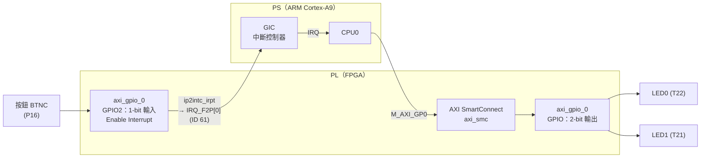
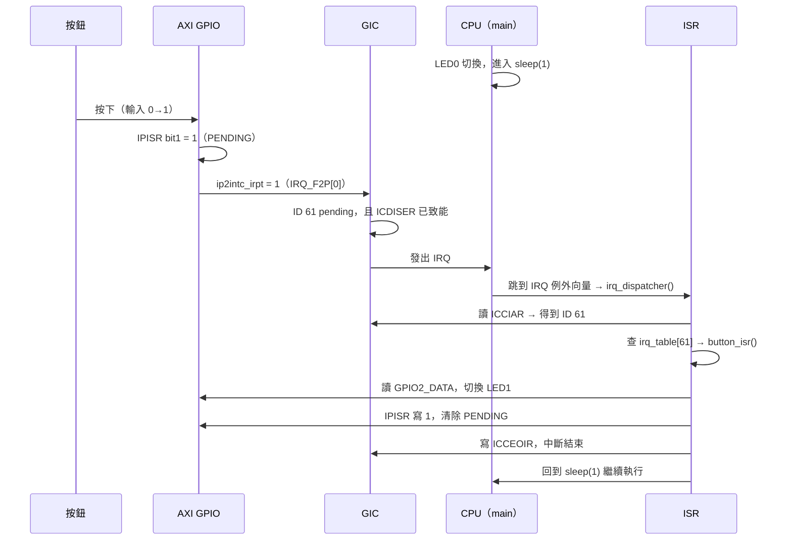

# System-on-Chip-SoC-Design-Internship_HW2
# HW2 作業 2：以中斷控制 LED（Zynq-7020 / EGO-XZ7）

> **功能**：LED0 每秒閃一次（延續作業 1）；按下按鈕時，透過**硬體中斷**讓 LED1 **立刻**切換亮暗。

| 項目 | 內容 |
|---|---|
| 開發板 | EGO-XZ7 |
| 晶片 | Xilinx Zynq-7000 **XC7Z020-CLG484-1** |
| 工具 | Vivado 2026.1、Vitis Unified IDE 2026.1 |
| 處理器 | ARM Cortex-A9（`ps7_cortexa9_0`），standalone（bare-metal） |
| 程式執行位置 | 晶片內部記憶體 OCM（`ps7_ram_0`） |

---

## 目錄

1. [作業目標](#1-作業目標)
2. [系統架構](#2-系統架構)
3. [中斷相關暫存器（IRQ 編號、PENDING、MASK）](#3-中斷相關暫存器)
4. [硬體設計（Vivado）](#4-硬體設計vivado)
5. [軟體設計（Vitis）](#5-軟體設計vitis)
6. [建置與執行步驟](#6-建置與執行步驟)
7. [實驗結果](#7-實驗結果)
8. [觀察與討論](#8-觀察與討論)
9. [遇到的問題與解決方法](#9-遇到的問題與解決方法)
10. [檔案說明](#10-檔案說明)
11. [參考資料](#11-參考資料)

---

## 1. 作業目標

- [x] LED0 每 1 秒切換一次（主程式 + `sleep(1)`）
- [x] 按下按鈕 BTNC → 產生中斷 → ISR 切換 LED1
- [x] 找出並使用以下三項：
  1. **IRQ 編號**
  2. **PENDING 暫存器**（中斷狀態）
  3. **MASK 暫存器**（中斷致能）
- [x] 自己設定 GIC，並建立 **IRQ table**（中斷編號 → ISR）

**重點**：主程式大部分時間都在 `sleep(1)` 裡。如果用輪詢（polling）讀按鈕，最慢要等 1 秒才會反應；改用中斷後，按下按鈕的瞬間 CPU 就會被打斷、跳去執行 ISR，所以 LED1 會**立刻**反應。

---

## 2. 系統架構

### 2.1 方塊圖



### 2.2 中斷處理流程



---

## 3. 中斷相關暫存器

本作業的中斷會經過**兩層**控制：AXI GPIO（中斷來源）和 GIC（中斷控制器）。兩層各自都有 PENDING 和 MASK。

### 3.1 IRQ 編號

| 訊號 | GIC 中斷編號（ID） | 類型 | 出處 |
|---|---|---|---|
| `IRQ_F2P[0]` | **61** | SPI（Shared Peripheral Interrupt） | UG585 第 7 章，中斷對照表 |

PL 送到 PS 的中斷 `IRQ_F2P[7:0]` 對應 ID 61～68，`IRQ_F2P[15:8]` 對應 ID 84～91。本設計只接一條中斷線，所以是 **ID 61**。

### 3.2 AXI GPIO 的中斷暫存器（基底位址 `0x4120_0000`，PG144）

| 暫存器 | 位址 | 用途 | 本作業的設定 |
|---|---|---|---|
| GIER | `0x4120_011C` | 全域中斷致能（bit31） | 寫 `0x8000_0000` |
| **IPIER**（**MASK**） | `0x4120_0128` | 各通道中斷致能，bit0 = 通道 1，bit1 = 通道 2 | 寫 `0x2`（只開按鈕通道） |
| **IPISR**（**PENDING**） | `0x4120_0120` | 中斷狀態，**寫 1 清除** | ISR 結束前寫 `0x2` |

### 3.3 GIC 的中斷暫存器（UG585 附錄 B）

| 暫存器 | 位址 | 用途 |
|---|---|---|
| ICDDCR | `0xF8F0_1000` | Distributor 致能 |
| **ICDISER0～2**（**MASK**） | `0xF8F0_1100` 起 | **Set-Enable**，每個 ID 佔 1 bit，寫 1 = 開啟。ID 61 在 `ICDISER1`（`0xF8F0_1104`）的 **bit29** |
| ICDICER0～2 | `0xF8F0_1180` 起 | Clear-Enable，寫 1 = 關閉（遮蔽） |
| **ICDISPR0～2**（**PENDING**） | `0xF8F0_1200` 起 | **Set-Pending**，讀出 = 目前哪些中斷在等待處理。ID 61 在 `ICDISPR1`（`0xF8F0_1204`）的 **bit29** |
| ICDICPR0～2 | `0xF8F0_1280` 起 | Clear-Pending |
| ICDIPR | `0xF8F0_1400` 起 | 優先權，每個 ID 佔 1 byte |
| ICDIPTR | `0xF8F0_1800` 起 | 目標 CPU，每個 ID 佔 1 byte |
| ICDICFR | `0xF8F0_1C00` 起 | 觸發型態，每個 ID 佔 2 bit（`01` = 高準位） |
| ICCICR | `0xF8F0_0100` | CPU Interface 致能 |
| ICCPMR | `0xF8F0_0104` | 優先權遮罩 |
| ICCIAR | `0xF8F0_010C` | **讀取 = 確認中斷，低 10 bit 為 ID** |
| ICCEOIR | `0xF8F0_0110` | **寫入 = 中斷處理完畢** |

> ID 61 的位置計算：`61 / 32 = 1` → 第 1 個暫存器；`61 % 32 = 29` → bit29。

---

## 4. 硬體設計（Vivado）

### 4.1 Block Design


| 元件 | 設定 |
|---|---|
| **ZYNQ7 Processing System** | M_AXI_GP0 開啟；FCLK_CLK0 = 50 MHz；**Interrupts → Fabric Interrupts → IRQ_F2P[15:0] 開啟**；EMIO GPIO 不開 |
| **AXI GPIO**（`axi_gpio_0`） | GPIO：All Outputs，寬度 2；**Enable Dual Channel**；GPIO2：All Inputs，寬度 1；**Enable Interrupt** |
| AXI SmartConnect（`axi_smc`） | Connection Automation 自動加入 |
| Processor System Reset（`rst_ps7_0_50M`） | Connection Automation 自動加入 |
| **中斷線** | `axi_gpio_0/ip2intc_irpt` → `processing_system7_0/IRQ_F2P[0:0]`（手動連線） |
| 外接腳位 | GPIO → `LED`，GPIO2 → `BTN` |

**建立步驟摘要：**

1. 新專案，Part 選 `xc7z020clg484-1`（EGO-XZ7 沒有 board file）
2. Create Block Design → 加入 ZYNQ7 PS → Run Block Automation（不套用 Board Preset）
3. 雙擊 Zynq：開啟 M_AXI_GP0、FCLK_CLK0、**IRQ_F2P**
4. 加入 AXI GPIO，設成雙通道並開啟中斷
5. Run Connection Automation（GPIO、GPIO2、S_AXI）
6. **手動把 `ip2intc_irpt` 拉到 `IRQ_F2P`**
7. 外接腳位改名為 `LED`、`BTN`
8. Validate（F6）→ Create HDL Wrapper → 加入 XDC → Generate Bitstream
9. Export Hardware（**Include bitstream**）→ `design_1_wrapper.xsa`

### 4.2 Address Map


| Slave | Base Address | Range |
|---|---|---|
| `axi_gpio_0/S_AXI` | `0x4120_0000` | 64K |

| 偏移 | 暫存器 | 用途 |
|---|---|---|
| `0x000` | GPIO_DATA | LED（bit0 = LED0、bit1 = LED1） |
| `0x004` | GPIO_TRI | LED 方向（0 = 輸出） |
| `0x008` | GPIO2_DATA | 按鈕（按下 = 1） |
| `0x00C` | GPIO2_TRI | 按鈕方向（1 = 輸入） |

### 4.3 腳位限制（[`vivado/pin.xdc`](vivado/pin.xdc)）

| 頂層腳位 | 晶片腳 | 板上元件 | 方向 | I/O 標準 |
|---|---|---|---|---|
| `LED_tri_o[0]` | **T22** | LED0 | 輸出 | LVCMOS33 |
| `LED_tri_o[1]` | **T21** | LED1 | 輸出 | LVCMOS33 |
| `BTN_tri_i[0]` | **P16** | BTNC（中間按鈕） | 輸入 | LVCMOS33 |

腳位依據：EGO-XZ7 硬體手冊表 15。

LED 和按鈕都是非同步、慢速的 I/O，所以加上 `set_false_path`，消除 TIMING-18（缺少 input/output delay）的 Methodology 警告。


### 4.4 實作結果


- Synthesis、Implementation、Bitstream 全部完成
- WNS、WHS 皆為正值，時序符合要求

---

## 5. 軟體設計（Vitis）

程式碼：[`vitis/main_irq.c`](vitis/main_irq.c)

本作業**不使用** Xilinx 的 `XScuGic` / `XGpio` 驅動程式，而是**直接讀寫暫存器**，自己完成 GIC 設定和 IRQ table，藉此理解中斷的實際運作過程。

### 5.1 程式結構

| 函式 | 功能 |
|---|---|
| `main()` | 初始化 GPIO、GIC、AXI GPIO 中斷、CPU 例外處理，接著進入 LED0 閃爍迴圈 |
| `gic_enable_irq()` | 在 GIC 開啟某個中斷：填 IRQ table、設定優先權、目標 CPU、觸發型態、**ICDISER 致能** |
| `irq_dispatcher()` | IRQ 總入口：**讀 ICCIAR → 查 IRQ table → 寫 ICCEOIR** |
| `button_isr()` | 按鈕的 ISR：切換 LED1、**清除 IPISR** |

### 5.2 初始化順序

```c
/* 1. GPIO 方向 */
Xil_Out32(GPIO_BASE + GPIO_TRI,  0x0);       /* 通道 1：LED 輸出   */
Xil_Out32(GPIO_BASE + GPIO2_TRI, 0x1);       /* 通道 2：按鈕輸入   */

/* 2. GIC：開啟 ID 61，填入 IRQ table */
Xil_Out32(ICDDCR, 0x0);
gic_enable_irq(BTN_IRQ_ID, 0xA0, button_isr);
Xil_Out32(ICDDCR, 0x1);                      /* Distributor 開啟   */
Xil_Out32(ICCPMR, 0xF0);                     /* 優先權 < 0xF0 放行 */
Xil_Out32(ICCICR, 0x07);                     /* CPU Interface 開啟 */

/* 3. AXI GPIO 中斷 */
Xil_Out32(GPIO_BASE + GPIO_IPISR, Xil_In32(GPIO_BASE + GPIO_IPISR)); /* 清掉舊的 PENDING */
Xil_Out32(GPIO_BASE + GPIO_IPIER, 0x2);      /* MASK：只開通道 2   */
Xil_Out32(GPIO_BASE + GPIO_GIER,  0x80000000U);

/* 4. 讓 CPU 接受 IRQ（清除 CPSR 的 I bit） */
Xil_ExceptionInit();
Xil_ExceptionRegisterHandler(XIL_EXCEPTION_ID_IRQ_INT,
                             (Xil_ExceptionHandler)irq_dispatcher, NULL);
Xil_ExceptionEnable();
```

### 5.3 IRQ table 與 dispatcher

```c
typedef void (*isr_t)(void);
static isr_t irq_table[96];           /* irq_table[61] = button_isr */

static void irq_dispatcher(void *unused)
{
    u32 iar = Xil_In32(ICCIAR);       /* 1. 確認中斷，取得編號 */
    u32 id  = iar & 0x3FFU;
    if (id < 96 && irq_table[id])
        irq_table[id]();              /* 2. 查表，呼叫 ISR */
    Xil_Out32(ICCEOIR, iar);          /* 3. 通知 GIC 處理完畢 */
}
```

### 5.4 ISR

```c
static void button_isr(void)
{
    if (Xil_In32(GPIO_BASE + GPIO2_DATA) & 0x1U) {  /* 只在「按下」時動作 */
        led_shadow ^= 0x2U;                         /* 切換 LED1 */
        led_write();
    }
    Xil_Out32(GPIO_BASE + GPIO_IPISR, 0x2U);        /* 清除 PENDING */
}
```

- AXI GPIO 在輸入**有任何變化**時都會發中斷（按下、放開各一次），所以要先判斷按鈕目前是 1 才切換
- **一定要清除 IPISR**：AXI GPIO 的中斷是高準位訊號，不清除的話中斷線會一直維持 1，CPU 一離開 ISR 就會馬上再進來

### 5.5 主程式與共用變數

```c
static volatile u32 led_shadow = 0;   /* bit0 給 main，bit1 給 ISR */

while (1) {
    Xil_ExceptionDisable();           /* 臨界區段 */
    led_shadow ^= 0x1U;               /* 切換 LED0 */
    led_write();
    Xil_ExceptionEnable();
    sleep(1);
}
```

- `led_shadow` 同時被主程式和 ISR 修改，所以要宣告為 **`volatile`**，避免編譯器把它暫存在暫存器裡
- 主程式在「讀取 → 修改 → 寫回」`led_shadow` 的期間暫時關閉中斷（**critical section**），避免 ISR 在中間插入，導致 LED1 的變化被主程式蓋掉

---

## 6. 建置與執行步驟

### 6.1 Vivado

1. 依照 [4.1](#41-block-design) 建立 Block Design
2. 加入 [`vivado/pin.xdc`](vivado/pin.xdc)
3. Generate Bitstream
4. File → Export → Export Hardware → **Include bitstream** → `design_1_wrapper.xsa`

### 6.2 Vitis（腳本自動建立）

中文版 Windows 直接開 Vitis 會遇到編碼錯誤，所以改用 Vitis 的 Python API 搭配批次檔建立專案：

1. 把 `vitis/` 裡的三個檔案和 `design_1_wrapper.xsa` 放在同一個資料夾
2. 按兩下 [`run_irq.bat`](vitis/run_irq.bat)，它會：
   - 設定 UTF-8 環境（`chcp 65001`、`PYTHONUTF8=1`）
   - 在 `C:\vitis_irq\ws` 建立 Platform（`irq_platform`）和 Application（`led_irq`，`empty_application` 範本）
   - 把 [`main_irq.c`](vitis/main_irq.c) 複製成 `main.c`
   - 把 `lscript.ld` 的記憶體區段改成 `ps7_ram_0`（OCM）
   - 編譯出 `led_irq.elf`，接著打開 Vitis
3. 在 Vitis 左下 **FLOW → Component** 選 `led_irq` → **Run**


### 6.3 板子設定（EGO-XZ7）

| 項目 | 設定 |
|---|---|
| SW8 第 1 位 | **0**（Cascaded JTAG） |
| SW8 第 4:2 位 | **000**（JTAG 開機模式） |
| SW8 第 5 位 | 0（使用 PLL） |
| 電源 | 12V 接 J9，S1 開啟（D17 亮） |
| JTAG | Micro USB 接 J1 |

修改 SW8 後要**斷電再上電**，開機模式才會生效。

---

## 7. 實驗結果


| 測試動作 | 預期結果 | 實際結果 |
|---|---|---|
| 不按按鈕 | LED0 每秒切換一次，LED1 不變 | ✅ 符合 |
| 按一下 BTNC | LED1 **立刻**切換 | ✅ 符合 |
| 再按一下 | LED1 切換回來 | ✅ 符合 |
| 按住不放 | LED1 只切換一次 | ✅ 符合 |
| 在 LED0 切換的空檔按下 | LED1 不用等到下一秒就會反應 | ✅ 符合 |

---

## 8. 觀察與討論

### 8.1 中斷 vs. 輪詢

| | 輪詢（polling） | 中斷（interrupt） |
|---|---|---|
| 做法 | 主程式定期讀 GPIO2_DATA | 按鈕變化時硬體主動通知 CPU |
| 反應時間 | 最慢要等一次迴圈（本作業約 1 秒） | 幾微秒內 |
| CPU 負擔 | 不停地讀，浪費時間 | 平常不用管，有事才處理 |

本作業中，主程式幾乎一直停在 `sleep(1)` 裡，但按下按鈕後 LED1 仍然**立刻**反應，證明是中斷把 CPU 從主程式拉去執行 ISR。

### 8.2 按鈕彈跳（bounce）

偶爾按一次按鈕，LED1 會切換兩次。這是因為機械按鈕在接觸的瞬間會快速跳動數毫秒，產生好幾次 0→1 的變化，每次都會觸發中斷。

可能的改善方法：
- **軟體去彈跳**：ISR 記錄上次觸發的時間，間隔小於 20 ms 就忽略
- **硬體去彈跳**：在 PL 加一個去彈跳電路（取樣後連續 N 次相同才承認）

### 8.3 為什麼要兩層 PENDING / MASK

- **AXI GPIO 層**（IPISR / IPIER）：決定**這個周邊**的哪些事件要發出中斷
- **GIC 層**（ICDISPR / ICDISER）：決定**整個系統**的哪些中斷編號要送給哪顆 CPU

兩層都打開，中斷才會到達 CPU；處理完也要兩層都收尾：清除 IPISR，並寫 ICCEOIR。

---

## 9. 遇到的問題與解決方法

| 問題 | 原因 | 解決方法 |
|---|---|---|
| Vivado 2026.1 出現 no licensed parts | 2026.1 需要免費的 BASIC tier 授權 | 到 AMD 授權網站申請 BASIC 授權 |
| 找不到 EGO-XZ7 的 Board 檔 | 廠商沒有提供 board file | 改用 Part `xc7z020clg484-1`，腳位自己寫 XDC |
| Wrapper 出現 `LED_tri_io` | 誤開了 EMIO GPIO，或 AXI GPIO 沒選 All Outputs | 關閉 EMIO，AXI GPIO 選 All Outputs |
| `[BD 41-758]` 時脈沒接 | Connection Automation 沒跑完整 | 重跑 Connection Automation，確認 FCLK_CLK0 有接 |
| Vitis 選單沒有 Platform / Application | 中文版 Windows 編碼為 Big5，Vitis 後端出現 `'utf-8' codec can't decode` | 用 `chcp 65001`、`PYTHONUTF8=1`，改用 Python API 建立專案 |
| `hello_world` 範本建立失敗 | 設計中沒有開 UART | 改用 `empty_application` 範本 |
| `Vitis IDE cannot recognize the workspace version` | 資料夾裡有失敗時殘留的 `_ide` | 改用全新的子資料夾 `ws` 當 workspace |
| `Could not find ARM device on the board` | SW8 為出廠設定（分離 JTAG + SD 卡開機） | SW8 第 1～5 位撥到 0，斷電再上電 |

---

## 10. 檔案說明

```
.
├── README.md              本說明文件
├── vivado/
│   └── pin.xdc            腳位限制（LED0、LED1、BTNC）
├── vitis/
│   ├── main_irq.c         C 程式：GIC 設定、IRQ table、ISR
│   ├── make_irq.py        Vitis Python API 腳本：建立 Platform、App 並編譯
│   └── run_irq.bat        一鍵執行：設定 UTF-8、執行腳本、開啟 Vitis
└── images/                報告截圖
```

---

## 11. 參考資料

- AMD/Xilinx, *Zynq-7000 SoC Technical Reference Manual* (**UG585**)
  - 第 7 章 Interrupts（GIC 架構、IRQ_F2P 中斷編號）
  - 附錄 B Register Details（ICD / ICC 暫存器）
- AMD/Xilinx, *AXI GPIO LogiCORE IP Product Guide* (**PG144**)：GIER、IPIER、IPISR
- AMD/Xilinx, *Zynq-7000 SoC Software Developers Guide* (**UG821**)
- AMD, *Vitis Unified Software Platform Documentation* (**UG1400**)：Vitis Python API
- *EGO-XZ7 硬體手冊* V1.2：表 1（板上資源）、表 5 / 表 19（SW8 開機模式）、表 15（LED、按鈕腳位）
